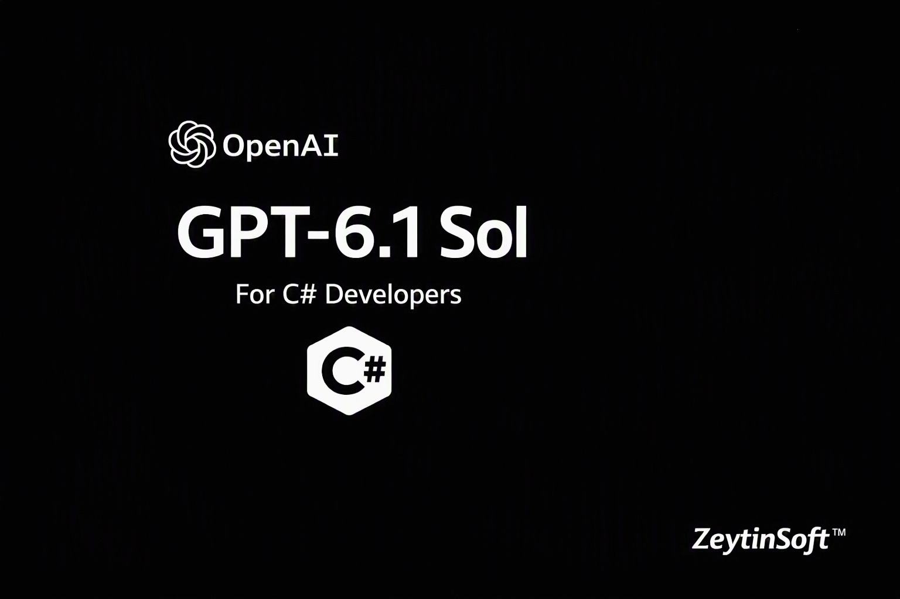

# GPT-6.1 Sol for C# Developers

> A runnable .NET 10 console app that calls **GPT-6.1 Sol** in **Microsoft Foundry** through `Microsoft.Extensions.AI`, covering PR triage, an approval-gated tool call, an evidence-bound vendor review and a reasoning-effort cost comparison.



[](https://github.com/taswar/Gpt-6.1-Sol-CSharp-Demo/actions/workflows/dotnet.yml)

[](LICENSE)
[](CONTRIBUTING.md)

- 📖 Full walkthrough: [GPT-6.1 Sol for C# Developers](https://taswar.zeytinsoft.com/gpt-6-1-sol-csharp-developers-guide/?utm_source=github&utm_medium=readme&utm_campaign=Gpt-6.1-Sol-CSharp-Demo&utm_content=walkthrough)
- ⭐ If this sample helps you, star the repo so other .NET developers can find it.
- 🔁 Related: [GPT-6 Astra C# Demo](https://github.com/taswar/GptSixAstraDemo)
- For more C# samples using other AI models, see [AI models for C# developers](https://taswar.zeytinsoft.com/foundry-ai-models-csharp/?utm_source=github&utm_medium=readme&utm_campaign=Gpt-6.1-Sol-CSharp-Demo&utm_content=ai-models-hub)
- For my free ebook on prompt engineering, see [Prompt Engineering for .NET Developers](https://github.com/taswar/PromptEngineeringForDotNetDevelopers)

It's one `Program.cs` with no wrapper library. Each sample prints its token usage, so you can see what the work costs before you put it into a pipeline.

## What's inside

| # | Sample | What it shows |
|---|--------|---------------|
| 1 | **PR triage** | Reviews a CI failure, separates observed facts from hypotheses and suggests one reproducible next test. It never approves or merges. |
| 2 | **Approval-gated change** | Calls a read-only `LookUpAccount` tool, then returns a typed `ProposedChange` record for a human to approve. Nothing is written. |
| 3 | **Vendor review** | Reviews SLA and incident notes, cites the source label for every finding, and tells a *missing* fact apart from a *negative* one. |
| 4 | **Reasoning effort** | Runs the Case 1 prompt at `Low`, `Medium` and `High` effort and compares token usage and latency. |

Each sample prints a usage line like this one:

```
[pr-triage] input=77 cached=0 output=256 reasoning=156 elapsed=10.6s
```

## Prerequisites

- **.NET 10 SDK**
- An Azure subscription with a **Microsoft Foundry** resource and a **GPT-6.1 Sol** deployment
- The **Azure CLI**, signed in with `az login`, and the **Cognitive Services OpenAI User** role on the resource. Authentication goes through Entra ID (`DefaultAzureCredential`) by default.
- Or an API key for the resource, if you'd rather skip Entra ID for a first try (see step 1).

## Run it

**1. Clone the repo and store your settings** (user secrets are kept outside the repo):

```bash
git clone https://github.com/taswar/Gpt-6.1-Sol-CSharp-Demo.git
cd Gpt-6.1-Sol-CSharp-Demo
dotnet user-secrets set "AZURE_AI_ENDPOINT" "https://<your-resource>.cognitiveservices.azure.com/"
dotnet user-secrets set "AZURE_OPENAI_DEPLOYMENT" "gpt-6.1-sol"
```

Use the resource's base endpoint. The app appends `openai/v1/` itself. The deployment name defaults to `gpt-6.1-sol`, so you only need that line if yours is named differently.

To use an API key instead of Entra ID, also run `dotnet user-secrets set "AZURE_OPENAI_API_KEY" "<your-api-key>"` and skip `az login`. The app sends the key in the `api-key` header.

**2. Sign in and run:**

```bash
az login
dotnet run
```

**3. Optional: triage your own CI output.** Pass a file and it replaces the built-in CI summary in Cases 1 and 4:

```bash
dotnet run -- ./ci-failure.txt
```

**4. Optional: run it on every pull request.** [`ci/pr-triage.yml`](ci/pr-triage.yml) is an example GitHub Actions workflow that runs your tests and, only when they fail, sends the last 200 lines of output to Sol and writes the triage to the job summary. It signs in with OIDC, so no API key is stored in GitHub. Copy it into your own repository's `.github/workflows/` folder; the comments at the top list the setup.

## Why the Responses API?

The app uses the Responses API (`/openai/v1/responses`) instead of Chat Completions. GPT-6.1 Sol rejects function tools combined with reasoning on `/chat/completions`:

```
HTTP 400 ... Function tools with reasoning_effort are not supported for gpt-6-sol
in /v1/chat/completions. To use function tools, use /v1/responses or set
reasoning_effort to 'none'.
```

Case 2 needs both, so the client is built like this:

```csharp
// Entra ID by default; an api-key header when AZURE_OPENAI_API_KEY is set.
AuthenticationPolicy authPolicy = string.IsNullOrWhiteSpace(apiKey)
    ? new BearerTokenPolicy(new DefaultAzureCredential(), "https://cognitiveservices.azure.com/.default")
    : ApiKeyAuthenticationPolicy.CreateHeaderApiKeyPolicy(new ApiKeyCredential(apiKey), "api-key");

IChatClient chat = new ResponsesClient(
        authPolicy,
        new ResponsesClientOptions { Endpoint = new Uri(new Uri(endpoint), "openai/v1/") })
    .AsIChatClient(deployment)
    .AsBuilder()
    .UseFunctionInvocation()
    .UseOpenTelemetry(sourceName: "Gpt-6.1-Sol-CSharp-Demo")
    .Build();
```

The OpenAI SDK marks the Responses types as experimental, which is why `Program.cs` starts with `#pragma warning disable OPENAI001`.

## Good to know

- **Live calls cost money.** One run makes at least six model requests (Case 2 makes extra calls while it uses the tool), and Case 4 deliberately runs at `High` effort.
- **The samples are simulations.** The account lookup, the CI result and the vendor documents are all hard-coded in `Program.cs`. Nothing touches a real system.
- **Output varies.** Responses are model-generated and differ between runs. Compare token counts across several runs, not just one.
- **Every call shares one 5-minute timeout,** and each HTTP request has a 3-minute network timeout.

## Troubleshooting

| Error | Likely cause | Fix |
|-------|--------------|-----|
| `404 DeploymentNotFound` | `AZURE_OPENAI_DEPLOYMENT` doesn't match a deployment on the resource | Set it to the exact deployment name. A brand-new deployment can take about 5 minutes to become available. |
| `400 ... Function tools with reasoning_effort are not supported` | The client is calling Chat Completions | Use the `ResponsesClient` setup shown above |
| `401` / `403` | Missing role, `az login` signed in to the wrong tenant, or a bad API key | Assign **Cognitive Services OpenAI User**, then run `az login --tenant <id>`; or check the key |
| `InvalidOperationException: AZURE_AI_ENDPOINT is not set` | User secrets are missing | Run the `dotnet user-secrets set` commands from inside the project folder |

## Dependencies

| Package | Version | Purpose |
|---------|---------|---------|
| `Microsoft.Extensions.AI` | 10.10.0 | `IChatClient`, function invocation, structured output, OpenTelemetry |
| `Microsoft.Extensions.AI.OpenAI` | 10.10.1 | `IChatClient` adapter for the OpenAI `ResponsesClient` (brings in `OpenAI` 2.14.0) |
| `Azure.Identity` | 1.21.0 | `DefaultAzureCredential` for Entra ID sign-in |
| `Microsoft.Extensions.Configuration.UserSecrets` | 10.0.12 | Local development secrets |
| `Azure.AI.OpenAI` | 2.1.0 | No longer used by `Program.cs`. Safe to remove. |

## Project layout

```
Gpt-6.1-Sol-CSharp-Demo.csproj   Target framework, NuGet references, UserSecretsId
Program.cs                       Client setup, the four samples, the usage reporter
GPT-6.1-Sol-CSharp-Developers.png  README banner image
CONTRIBUTING.md                  How to contribute
.github/workflows/dotnet.yml     Build workflow
ci/pr-triage.yml                 Example PR triage workflow (copy into your own repo)
```

## Learn more

- [GPT-6.1 Sol for C# Developers (blog post)](https://taswar.zeytinsoft.com/gpt-6-1-sol-csharp-developers-guide/?utm_source=github&utm_medium=readme&utm_campaign=Gpt-6.1-Sol-CSharp-Demo&utm_content=walkthrough)
- [GPT-6 Astra for C# Developers (blog post)](https://taswar.zeytinsoft.com/gpt-6-astra-csharp-developers-guide/?utm_source=github&utm_medium=readme&utm_campaign=Gpt-6.1-Sol-CSharp-Demo&utm_content=gpt-6-astra-csharp-developers-guide)
- [Introducing GPT-6.1 Sol in Microsoft Foundry](https://techcommunity.microsoft.com/blog/azure-ai-foundry-blog/introducing-gpt-6-1-sol-in-microsoft-foundry-advanced-intelligence-optimized-for/4560811)
- [Microsoft.Extensions.AI documentation](https://learn.microsoft.com/dotnet/ai/microsoft-extensions-ai)
- [.NET Secret Manager](https://learn.microsoft.com/aspnet/core/security/app-secrets)

## License

MIT. See [LICENSE](LICENSE).

If this saved you time, a ⭐ helps other .NET developers find it.
